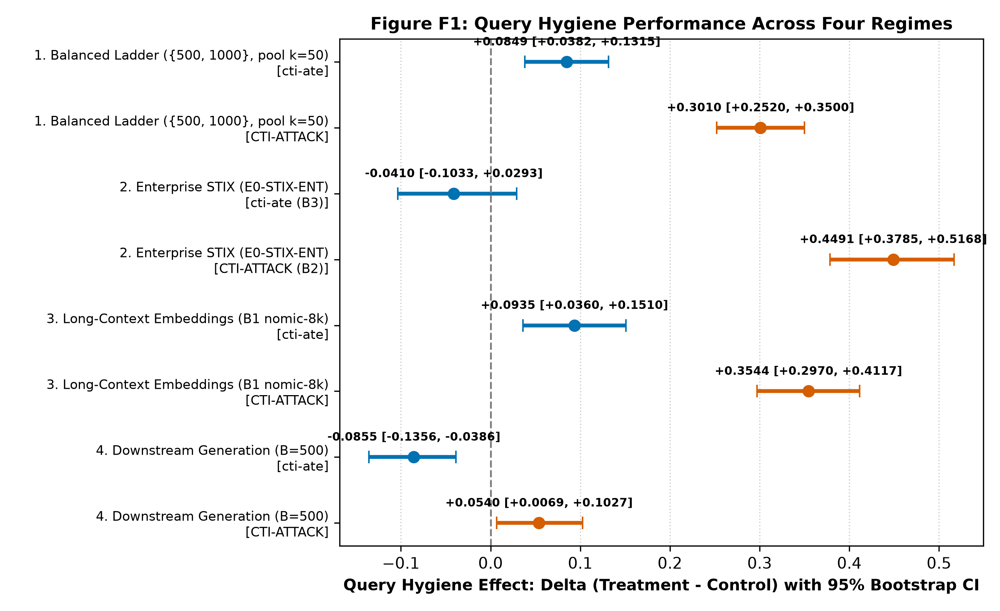
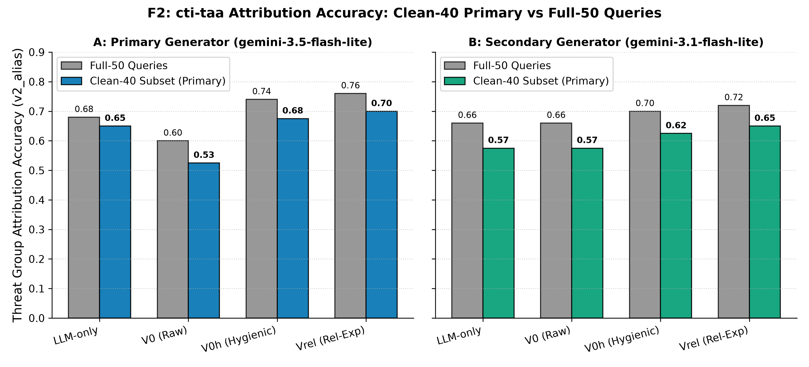
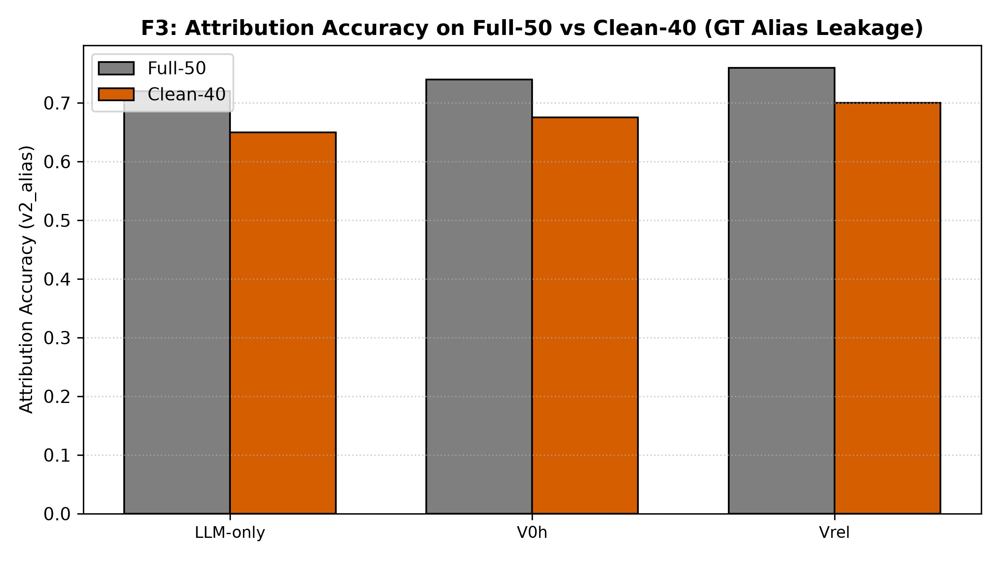
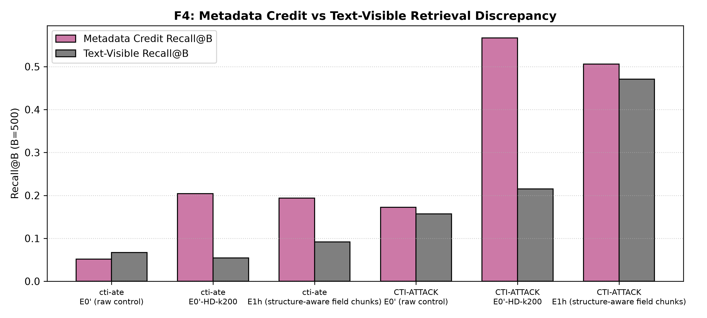
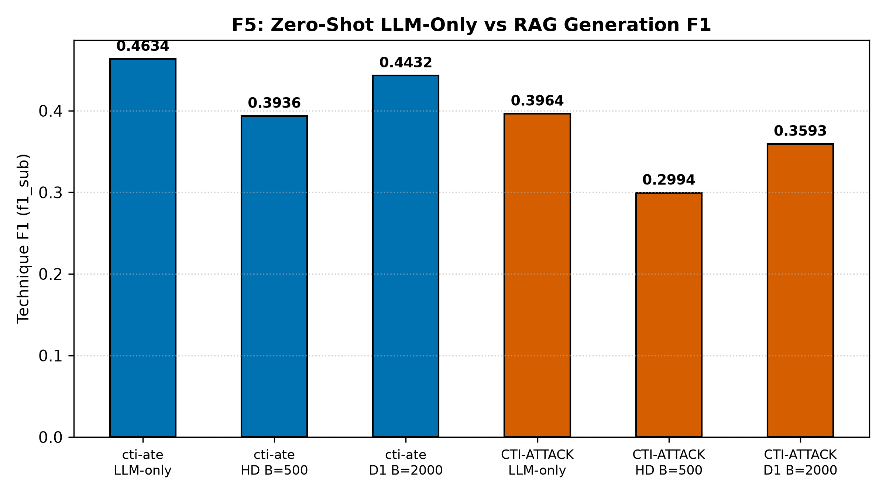

# RAGIntel Optimization: Empirical Evaluation, Retrieval Hygiene, and Benchmark Diagnostics for Cyber Threat Intelligence

[](LICENSE)
[](https://www.python.org/)
[](https://github.com/rohanreddy3/RAGIntel/releases/tag/v1.0-final4)
[](tests/)
[](scripts/verify_master.py)

---

## TL;DR

This project conducts an adversarial, evaluation-centered investigation into RAG for Cyber Threat Intelligence (CTI), optimizing the open-source RAGIntel framework across 339 benchmark queries.
We evaluate query hygiene, entity resolution, and structure-aware chunking against standalone LLM baselines.
Retrieval hygiene dramatically improves isolated recall, but downstream generation fails to beat zero-shot LLMs.
Crucially, we uncover systemic benchmark defects: prompt instruction contamination, 20% ground-truth alias leakage, and artificial metadata-credit inflation.
All code, per-query outputs, and statistical assertions are cryptographically frozen and verifiable offline.

---

## Key Findings

| Claim ID | Finding Summary | Metric | Effect / Contrast | Status Label |
| :--- | :--- | :--- | :--- | :--- |
| **C1** | Balanced query hygiene improves isolated retrieval recall | Mean Recall@B | $\Delta = +0.0849$ (ate) / $+0.3010$ (att) | **Robust** |
| **C2** | Enterprise STIX hygiene effect is baseline-dependent | Subtech_Recall@10 | $\Delta = -0.0410$ (ate B3) / $-0.0082$ (ate B2) / $+0.4491$ (att B2) | **Mixed** |
| **C3** | Long-context dense embeddings (B1) benefit from query hygiene | Subtech_Recall@10 | $\Delta = +0.0935$ (ate) / $+0.3544$ (att) | **Robust** |
| **C4** | Downstream generation hygiene hurts `cti-ate`, mixed on `CTI-ATTACK` | Technique F1 | $\Delta = -0.0855$ ($p=0.0127$, ate) / $+0.0540$ ($p=0.3553$, att) | **Mixed** |
| **C5** | Primary generation family: HD is significantly below zero-shot LLM-only | Technique F1 | $\Delta = -0.0970$ ($p=0.0007$, att) / $-0.0698$ ($p=0.0198$, ate) | **Robust (CTI-ATTACK) / Not Sig under Holm (cti-ate)** |
| **C6** | On `cti-taa` Clean-40, STIX graph expansion ($V_{\text{rel}}$) aids retrieval; generation is null | Recall@10 / v2_alias | Retrieval: $\Delta = +0.2000$ ($p=0.0078$); Gen: Null across generators | **Exploratory (Retrieval Sig / Generation Null)** |
| **C7** | Ground-truth alias leakage in 20% of `cti-taa` queries inflates accuracy to 100% | Leakage Share / Accuracy | 20.0% leakage; Leaked accuracy: 100% vs Clean accuracy: 52.5%–70.0% | **Robust Benchmark Defect** |
| **C8** | Query entity survival filtering improves detector precision | Real Entity Precision | $83.1\% \to 93.9\%$ ($+10.8$pp real entity precision) | **Exploratory Precision (Recall unmeasured, single annotator)** |
| **C9** | STIX metadata-credit tagging inflates recall over surface text matching | Recall@B ($B=500$) | Discrepancy: $+0.1496$ (ate) / $+0.3516$ (att) | **Robust Methodological Defect** |
| **C10** | Context budget expansion ($B=500 \to B=2000$) improves CTI-ATTACK only | Technique F1 | D1: $\Delta = +0.0599$ ($p=0.0008$, att) / $+0.0496$ ($p=0.0704$, ate); D4 null | **Exploratory** |

> **Honest Assessment of Negative Outcomes**: RAG did **not** improve downstream generation quality over standalone zero-shot LLMs. Optimization 2 (structure-aware field chunking, D3) degraded performance relative to baseline chunking, and query hygiene in downstream generation reduced technique extraction accuracy on `cti-ate`.

---

## Results

Detailed machine-readable data, LaTeX tables, and full vector graphics are indexed in [`results_for_report/README.md`](results_for_report/README.md).

### Embedded Figures

#### Figure F1: Query Hygiene Effect Across Evaluation Regimes


> **Figure F1**: Query hygiene delta across 4 evaluation regimes showing positive retrieval recall contrasting with negative (cti-ate: -0.0855, p=0.0127) or null (CTI-ATTACK: +0.0540, p=0.3553) downstream live generation impact (supports Claims C1, C2 [cti-ate 0.1221->0.0811, CTI-ATTACK 0.1812->0.6303], C3, C4).

---

#### Figure F2: CTI-TAA Clean-40 Threat Actor Attribution


> **Figure F2**: Threat actor attribution accuracy on cti-taa comparing Full-50 queries against the Clean-40 primary benchmark across primary and secondary generators (supports Claim C6).

---

#### Figure F3: Benchmark Prompt Ground-Truth Alias Leakage


> **Figure F3**: Share of cti-taa queries exhibiting ground-truth alias leakage in prompt bodies (20%) and resulting accuracy saturation (100%) on leaked vs clean subsets (supports Claim C7).

---

#### Figure F4: STIX Metadata-Credit Inflation Defect


> **Figure F4**: Recall@B at B=500 comparing STIX metadata-credit against surface text-visible matching, revealing +0.15 to +0.35 artificial recall inflation from structured metadata tags (supports Claim C9).

---

#### Figure F5: Downstream Live Generation: RAG vs. Standalone LLM-Only


> **Figure F5**: Downstream live technique F1 across all evaluation arms (E0', HD B=500, D1 B=2000, D2 hybrid, D3 E1h, D4 hybrid) compared against the zero-shot LLM-only baseline with 95% bootstrap CIs (supports Claims C5, C10).

---

### Canonical Publication Tables

#### Table T3: Main Experimental Results Summary
| Claim | Metric | Dataset | Delta_ate | Delta_att | CI_ate | CI_att | WTL_ate | WTL_att | p_ate | p_att | Source | Status |
| :--- | :--- | :--- | :--- | :--- | :--- | :--- | :--- | :--- | :--- | :--- | :--- | :--- |
| C1 | Mean Recall@B | cti-ate (N=60) & CTI-ATTACK (N=229) | +0.0849 | +0.3010 | from Phase 6B run; per-query data not archived; not re-derivable | from Phase 6B run; per-query data not archived; not re-derivable | from Phase 6B run; per-query data not archived; not re-derivable | from Phase 6B run; per-query data not archived; not re-derivable | from Phase 6B run; per-query data not archived; not re-derivable | from Phase 6B run; per-query data not archived; not re-derivable | results/phase_6b/assets/table_ladder_common_budgets.csv | Robust |
| C2 | Subtech_Recall@10 | cti-ate B3/B2 (N=60) & CTI-ATTACK B2 (N=229) | -0.0410 (B3) / -0.0082 (B2) | +0.4491 | [-0.1033, +0.0293] (B3) / [-0.0636, +0.0561] (B2) | [+0.3785, +0.5168] | 6/32/22 (B3) / 8/36/16 (B2) | 117/104/8 | 0.0037 (B3) / 0.1516 (B2) | <0.0001 | results/phase_6d/secondary_kb_contrasts.csv | Mixed |
| C3 | Recall@10 (Subtech_Recall@10) | cti-ate (N=60) & CTI-ATTACK (N=229) | +0.0935 | +0.3544 | [+0.0484, +0.1463] | [+0.2933, +0.4156] | 24/32/4 | 90/137/2 | 0.0002 | <0.0001 | results/phase_6d/b1_robustness_contrasts.csv | Robust |
| C4 | Technique F1 (f1_sub) | cti-ate (N=60) & CTI-ATTACK (N=229) | -0.0855 | +0.0540 | [-0.1356, -0.0386] | [+0.0069, +0.1027] | 17/7/36 | 64/112/53 | 0.0127 | 0.3553 | results/phase_6d/phase6g_corrections.json + results/phase_6c/contrasts_table.json | Mixed |
| C5 | Technique F1 (f1_sub) | CTI-ATTACK (GEN_02) & cti-ate (GEN_01) | -0.0698 | -0.0970 | [-0.1120, -0.0296] | [-0.1432, -0.0502] | 18/6/36 | 44/102/83 | 0.01983 (Holm alpha*=0.01667, Not Sig) | 0.00068 (Holm alpha*=0.0125, Sig) | results/phase_6d/holm_primary_generation.json + results/phase_6c/contrasts_table.json | Robust (CTI-ATTACK) / Not Sig under Holm (cti-ate) |
| C6 | Retrieval Recall@10 / Gen v2_alias | cti-taa Clean-40 (N=40) | +0.2000 | See headline table | [+0.0750, +0.3250] | N/A | 8/32/0 | N/A | 0.0078 | N/A | results/phase_6d/phase6g_corrections.json | Exploratory (Retrieval Sig / Generation Null) |
| C7 | Leakage Share / v2_alias Accuracy | cti-taa (N=50: Leaked=10, Clean=40) | 20.0% leakage | Fisher p (uncorrected, descriptive): LLM-only=0.0445, V0=0.0366, V0h=0.0463, Vrel=0.0920 | N/A (partition audit) | N/A | 10/10 leaked correct (LLM-only, V0h, Vrel); 9/10 (V0) | N/A | 0.0445 (LLM) / 0.0366 (V0) / 0.0463 (V0h) / 0.0920 (Vrel) [uncorrected, descriptive] | N/A | results/phase_6d/gt_alias_leakage_audit.json | Robust Benchmark Defect |
| C8 | Real Entity / Informative Precision | Annotated detector matches | +10.8pp real (83.1% -> 93.9%) | +23.2pp informative (70.8% -> 93.9%) | N/A (annotated sample) | N/A | 66 surviving / 89 raw | N/A | N/A (counts only; no valid binomial null) | N/A | results/phase_6d/phase6g_corrections.json (item6) | Exploratory Precision (Recall unmeasured, single annotator) |
| C9 | Recall@B (B=500) | cti-ate & CTI-ATTACK | +0.1496 | +0.3516 | N/A (deterministic scoring difference) | N/A | metadata=0.2042 text=0.0546 | metadata=0.5670 text=0.2154 | N/A (deterministic scoring discrepancy; no valid test) | N/A | results/phase_6d/metadata_credit_audit.json | Robust Methodological Defect |
| C10 | Technique F1 (f1_sub) | cti-ate (N=60) & CTI-ATTACK (N=229) | +0.0496 (D1) / +0.0354 (D4) | +0.0599 | [+0.0030, +0.0969] | [+0.0212, +0.0985] | 33/8/19 (D1) | 60/141/28 | 0.0704 (D1 sign p) / p=0.0704 (ate) / 0.6778 (D4 null) | 0.0008 | results/phase_6d/generation_contrasts.json | Exploratory |

---

#### Table T4: Statistical Multiplicity Testing & Holm Corrections
| Family | Rank | ID | Comparison | Metric | Delta | WTL | p_raw | Holm_threshold | Decision |
| :--- | :--- | :--- | :--- | :--- | :--- | :--- | :--- | :--- | :--- |
| Primary (M=4) | 1 | GEN_02 | HD vs LLM-only (CTI-ATTACK) | f1_sub | -0.0970 | 44/102/83 | 0.0007 | 0.0125 | Statistically Significant |
| Primary (M=4) | 2 | GEN_01 | HD vs LLM-only (cti-ate) | f1_sub | -0.0698 | 18/6/36 | 0.0198 | 0.01667 | Not Significant |
| Primary (M=4) | 3 | GEN_03 | V0h vs LLM-only (cti-taa) | v2_alias | +0.0200 | 7/37/6 | 1.0000 | 0.025 | Not Significant |
| Primary (M=4) | 4 | GEN_04 | Vrel vs V0h (cti-taa) | v2_alias | +0.0200 | 3/45/2 | 1.0000 | 0.05 | Not Significant |
| Post-hoc Hygiene (M=2, Exploratory) | 1 | HYG_01 | HD vs E0' (cti-ate) | f1_sub | -0.0855 | 17/7/36 | 0.0127 | 0.025 | Significant |
| Post-hoc Hygiene (M=2, Exploratory) | 2 | HYG_02 | HD vs E0' (CTI-ATTACK) | f1_sub | +0.0540 | 64/112/53 | 0.3553 | 0.05 | Not Significant |

---

#### Table T5: Query Entity Detector Precision (Single Annotator, AI-Draft Labels, Recall Unmeasured)
| Detector Stage | Sample Size | Real Entity Precision | Informative Attribution Precision | Notes | Error Class Breakdown |
| :--- | :--- | :--- | :--- | :--- | :--- |
| D0 (Raw Prompt Detections) | 100 matches | 74.0% (74/100) | 63.0% (63/100) | Raw prompt text; includes prompt instruction templates and general vocabulary. | - |
| D0 Body-Only (Templates Excluded) | 89 matches | 83.1% (74/89) | 70.8% (63/89) | Excludes 11 prompt instruction template detections (e.g. Crimson S0115, APT36 G0134). | - |
| D1/V1h (Body-Only + Survival Filter) | 66 matches | 93.9% (62/66) | 93.9% (62/66) | Removes 23 non-informative common words and generic OS utilities; 62 real & informative. | - |
| - | 11 detections (29.7%) | 100.0% (Real STIX objects) | 0.0% (Non-informative) | Matched in instruction prompt text: Crimson (S0115: IDs 7,40,72,92), APT36 (G0134: IDs 25,29,59,60,66,71,84). | Class 1: Prompt Instruction Templates |
| - | 15 detections (40.5%) | 0.0% - 26.7% | 0.0% (Non-informative) | Vocabulary collisions: equation (IDs 1,91), Photo (14), ps1 (16,35), net/Net/NET (21,33,39,45,48,57,58), ping (23), Soldier (24), Play (82). | Class 2: Common Words / .NET / Ping |
| - | 11 detections (29.7%) | 100.0% (Real ATT&CK tools) | 0.0% (Non-informative) | Generic OS tools in software: cmd.exe (IDs 10,17,27), ipconfig (32,55), ftp (67), netstat (74), net (93,95), schtasks.exe (96), systeminfo (99). | Class 3: Generic OS Utilities |

---

#### Table T6: Benchmark & Methodological Defects
| Defect | Scope | Impact | Mitigation | Source |
| :--- | :--- | :--- | :--- | :--- |
| GT Alias Leakage (C7) | cti-taa 10/50 queries (20.0%) | Leaked queries have 100% accuracy saturation across generators | Report clean-40 subset separately (Fisher p values uncorrected) | gt_alias_leakage_audit.json |
| Metadata Credit (C9) | All datasets (Phase 5/6) | Recall@B inflated by +0.1496 (ate) / +0.3516 (att) | Report text-visible alongside metadata values | metadata_credit_audit.json |
| S9000-Series Objects | 62 objects in bundle | Authentic upstream MITRE draft objects present in STIX snapshot | Documented in kb_integrity_audit.csv | kb_integrity_audit.json |

---

#### Headline Generation Comparison Table (`cti-taa`)
| Section (Metric) | Arm | Full-50 | Clean-40 | Source File |
| :--- | :--- | :---: | :---: | :--- |
| Retrieval Recall@10 | V0 (Raw prompt, no detector/hygiene) | 0.34 | 0.40 | `results/phase_6d/phase6g_corrections.json (item8)` |
| Retrieval Recall@10 | V0h (Hygienic body-only, no expansion) | 0.14 | 0.125 | `results/phase_6d/phase6g_corrections.json (item8)` |
| Retrieval Recall@10 | Vrel (Hygienic + STIX relationship exp) | 0.32 | 0.325 | `results/phase_6d/phase6g_corrections.json (item8)` |
| Primary Generator v2_alias | LLM-only | 0.72 | 0.65 | `results/phase_6d/phase6g_corrections.json (item8)` |
| Primary Generator v2_alias | V0 (Raw prompt RAG) | 0.60 | 0.525 | `results/phase_6d/phase6g_corrections.json (item8)` |
| Primary Generator v2_alias | V0h (Hygienic RAG) | 0.74 | 0.675 | `results/phase_6d/phase6g_corrections.json (item8)` |
| Primary Generator v2_alias | Vrel (Relationship RAG, standard prompt) | 0.76 | 0.70 | `results/phase_6d/phase6g_corrections.json (item8)` |
| Primary Generator v2_alias | Vrel (Relationship RAG, hybrid prompt) | 0.74 | 0.675 | `results/phase_6d/phase6g_corrections.json (item8)` |
| Secondary Generator v2_alias | LLM-only | 0.66 | 0.575 | `results/phase_6d/phase6g_corrections.json (item8)` |
| Secondary Generator v2_alias | V0 (Raw prompt RAG) | 0.66 | 0.575 | `results/phase_6d/phase6g_corrections.json (item8)` |
| Secondary Generator v2_alias | V0h (Hygienic RAG) | 0.70 | 0.625 | `results/phase_6d/phase6g_corrections.json (item8)` |
| Secondary Generator v2_alias | Vrel (Relationship RAG) | 0.72 | 0.65 | `results/phase_6d/phase6g_corrections.json (item8)` |

---

### Negative and Mixed Results

To preserve scientific rigor, all negative, mixed, and null findings are reported with equal prominence:

1. **HD (Hygiene + Domain Routing) is Below LLM-Only**:
   Across both technique extraction benchmarks, RAG with query hygiene and domain routing underperforms standalone zero-shot LLM generation. On `CTI-ATTACK`, HD is significantly below LLM-only ($\Delta = -0.0970, p=0.00068 \le 0.0125$ under Holm correction). On `cti-ate`, HD is also below LLM-only ($\Delta = -0.0698, p=0.0198$), though not significant after Holm step-down threshold ($\alpha^* = 0.01667$).
2. **Structure-Aware Chunking (O2 / D3) Fails to Beat Baseline Chunking**:
   Decomposing ATT&CK technique descriptions into field-specific chunks ($E_{1a}$ / $E_{1b}$ / D3) yields lower technique extraction scores than standard recursive character chunking ($E_0'$) and does not exceed HD.
3. **Hygiene vs. Raw on CTI-ATTACK Downstream Generation is a Statistical Tie**:
   Comparing downstream generation with hygiene (HD) against raw retrieval ($E_0'$) on `CTI-ATTACK` shows a modest positive mean ($\Delta = +0.0540$), but the paired sign test confirms a statistical tie ($p = 0.3553$, W/T/L = 64/112/53).
4. **cti-taa Attribution Shows No Significant Generation Advantage After Holm**:
   On threat actor attribution (`cti-taa`), while STIX relationship expansion ($V_{\text{rel}}$) significantly recovers retrieval recall ($\Delta = +0.2000, p=0.0078$), downstream generation accuracy gains are small (+0.0200 full / +0.0250 clean) and fail significance under family-wise correction ($p=1.0000$).
5. **Bidirectional-Credit Sensitivity Analysis**:
   When evaluated under parent/subtechnique bidirectional credit (resolving prompt instruction penalties where the prompt forbade subtechnique IDs while ground-truth contained them), LLM-only remains superior to all RAG configurations on `CTI-ATTACK`. On `cti-ate`, raw $E_0'$ vs. LLM-only is a statistical tie ($p=0.27$), not a win for LLM-only.

| Dataset | Arm | Description | $N$ | Std F1 (`f1_sub`) | Bidi Precision | Bidi Recall | Bidi F1 | $\Delta$ (Bidi vs Std) | Rank (Std) | Rank (Bidi) |
| :--- | :--- | :--- | :---: | :---: | :---: | :---: | :---: | :---: | :---: | :---: |
| `cti-ate` | LLM-only | Zero-shot parametric baseline | 60 | 0.4634 | 0.5780 | 0.5453 | 0.5494 | +0.0859 | 2 | 1 |
| `cti-ate` | $E_0'$ | True raw retriever control ($k=\text{all}, B=500$) | 60 | 0.4792 | 0.6103 | 0.4909 | 0.5313 | +0.0521 | 1 | 2 |
| `cti-ate` | HD | Domain routing + query hygiene ($k=200, B=500$) | 60 | 0.3936 | 0.5705 | 0.4041 | 0.4554 | +0.0617 | 4 | 4 |
| `cti-ate` | D1 | Domain routing + query hygiene ($k=200, B=2000$) | 60 | 0.4432 | 0.6157 | 0.4643 | 0.5144 | +0.0711 | 3 | 3 |
| `CTI-ATTACK` | LLM-only | Zero-shot parametric baseline | 229 | 0.3964 | 0.5299 | 0.7489 | 0.5834 | +0.1870 | 1 | 1 |
| `CTI-ATTACK` | $E_0'$ | True raw retriever control ($k=\text{all}, B=500$) | 229 | 0.2454 | 0.3609 | 0.5488 | 0.3960 | +0.1506 | 4 | 4 |
| `CTI-ATTACK` | HD | Domain routing + query hygiene ($k=200, B=500$) | 229 | 0.2994 | 0.4221 | 0.5713 | 0.4566 | +0.1572 | 3 | 3 |
| `CTI-ATTACK` | D1 | Domain routing + query hygiene ($k=200, B=2000$) | 229 | 0.3593 | 0.4914 | 0.6259 | 0.5249 | +0.1656 | 2 | 2 |

---

## Method Overview

The RAGIntel optimization pipeline addresses two architectural bottlenecks in threat intelligence RAG:
1. **Optimization 1 (O1 - Entity Resolution & Graph Expansion)**: Cyber threat actor attribution queries (`cti-taa`) are long reports where adversary names often appear late in the narrative or under informal aliases. O1 extracts threat entity aliases from query bodies, filters out prompt templates and generic utility false positives via survival filtering, and injects 1-hop STIX relationships ($V_{\text{rel}}$) into the retrieval representation.
2. **Optimization 2 (O2 - Structure-Aware Field Chunking)**: Decomposes semi-structured MITRE ATT&CK STIX objects into discrete semantic fields (`identity_description`, `procedure_examples`, `mitigations`, `detection`) to eliminate chunk boundary noise.

```
                    +--------------------------------------------+
                    | Raw Cyber Threat Intelligence (CTI) Report |
                    +--------------------------------------------+
                                          |
                                          v
                    +--------------------------------------------+
                    |   Query Hygiene (Body Marker Extraction)   |
                    | (Strip prompt templates & instruction noise)|
                    +--------------------------------------------+
                                          |
                     +--------------------+--------------------+
                     |                                         |
                     v                                         v
       [Threat Extraction Queries]                [Attribution Queries]
       (`cti-ate`, `CTI-ATTACK`)                       (`cti-taa`)
                     |                                         |
                     v                                         v
       +----------------------------+             +----------------------------+
       | Domain Routing (Enterprise)|             | O1 Entity Alias Extraction |
       | & Sliding Window MaxSim B3 |             | & STIX Graph Expansion Vrel|
       +----------------------------+             +----------------------------+
                     |                                         |
                     +--------------------+--------------------+
                                          |
                                          v
                    +--------------------------------------------+
                    |  Hybrid BM25 + Dense Retrieval (FlashRank) |
                    |       against MITRE ATT&CK STIX 2.1        |
                    +--------------------------------------------+
                                          |
                                          v
                    +--------------------------------------------+
                    |   Context Truncation / Budget Allocation   |
                    |          (B = 500 to 2000 tokens)          |
                    +--------------------------------------------+
                                          |
                                          v
                    +--------------------------------------------+
                    |      LLM Generation & Entity Scoring       |
                    |     (Gemini 3.5 / 3.1 Flash-Lite)          |
                    +--------------------------------------------+
```

---

## Datasets and Knowledge Base

| Dataset / KB | Type | Queries / Entities | License | Obtaining the Data |
| :--- | :--- | :---: | :--- | :--- |
| `cti-ate` | Technique Extraction | 60 | Apache-2.0 | Tracked in repo at [`data/datasets/cti-ate.xlsx`](data/datasets/cti-ate.xlsx). Upstream: CTIBench / RAGIntel. |
| `CTI-ATTACK` | Technique Extraction | 229 | Apache-2.0 | Tracked in repo at [`data/datasets/CTI-ATTACK.xlsx`](data/datasets/CTI-ATTACK.xlsx). Upstream: Dattaraj (2025) / RAGIntel. |
| `cti-taa` | Threat Actor Attribution | 50 (40 clean) | Apache-2.0 | Tracked in repo at [`data/datasets/cti-taa.xlsx`](data/datasets/cti-taa.xlsx). Upstream: CTIBench / RAGIntel. |
| MITRE ATT&CK Enterprise | Knowledge Base (`E0-STIX-ENT`) | 1,698 active entities | Apache-2.0 | Download via `python scripts/download_stix.py`. Exact SHA-256 and size in [`data/README.md`](data/README.md). |
| MITRE ATT&CK STIX-ALL | Knowledge Base (`E0-STIX-ALL`) | 2,062 active entities | Apache-2.0 | Combines Enterprise, Mobile, and ICS STIX bundles (snapshot 2026-07-31). |

---

## Repository Structure

```
.
├── analysis_plan.md        # Pre-declared protocol, families, and dated experimental amendments
├── config.yaml             # Retrieval and index configuration
├── config_generation.yaml  # Generation runner parameters
├── data/                   # Pinned benchmark spreadsheets and dataset documentation
├── docs/                   # Supporting documentation (reproduction, claim maps, review index)
├── report/                 # Descriptive reports, dataset statistics, and publication figure copies
├── results/                # Cryptographically frozen experimental outputs and manifest
├── results_for_report/     # Single source of truth: publication tables, figures, CSVs, and master ledger
├── reviews/                # Detailed review logs and adversarial audit reports across all phases
├── scripts/                # Data download, indexing, evaluation, table building, and verification code
├── src/                    # Core library (STIX parser, retrieval baselines, metrics, hygiene)
└── tests/                  # Pytest test suite (52 deterministic regression and unit tests)
```

---

## How to Reproduce

All evaluation artifacts, tables, figures, and statistical tests in this repository can be fully reproduced and verified **completely offline on CPU hardware**.

### Step 1: Set Up Environment
```bash
python -m venv venv
# Linux / macOS:
source venv/bin/activate
# Windows PowerShell:
.\venv\Scripts\Activate.ps1

pip install -r requirements.txt
```

### Step 2: Run Automated Consistency Verification
```bash
python scripts/verify_master.py
```
*Asserts 97 independent mathematical and programmatic checks across raw source files, markdown tables, and LaTeX tables. Expected result: 97 passed, 0 failed.*

### Step 3: Run Unit & Integration Test Suite
```bash
python -m pytest
```
*Executes 52 regression and unit tests covering retrieval determinism, STIX indexing, and metrics. Expected result: 52 passed.*

### Step 4: Rebuild Publication Tables and Figures
```bash
python scripts/build_results_master.py
```
*Reads raw per-query results from `results/` and regenerates `results_for_report/` (markdown tables, LaTeX tables, CSVs, and master ledgers).*

> **API Generation Note**: All model generations (`gemini-3.5-flash-lite`, `gemini-3.1-flash-lite`) are archived under `results/phase_6c/`, `results/phase_6d/`, and `results/phase_6l/`. **A Google Gemini API key is NOT required to reproduce or verify any table or figure in this repository.**

For full end-to-end instructions, see [`docs/REPRODUCE.md`](docs/REPRODUCE.md).

---

## Where to Find Figures and Tables

- **Publication Tables**: Available in Markdown, LaTeX, and CSV formats under [`results_for_report/tables/`](results_for_report/tables/).
- **Publication Figures**: Vector graphics (`.svg`), high-resolution rasters (`.png`), source numerical values (`.csv`), and captions (`.caption.txt`) are located in [`results_for_report/figures/`](results_for_report/figures/).
- **Machine-Readable Data**: Primary numerical claims are compiled in [`results_for_report/data/claims_master.csv`](results_for_report/data/claims_master.csv).
- **Claim Mapping**: See [`docs/RESULTS_GUIDE.md`](docs/RESULTS_GUIDE.md) to map any specific claim ID ($C_1$–$C_{10}$) directly to its raw source artifact.

---

## Limitations

1. **Small Benchmark Sample Sizes**: `cti-taa` contains only $N=50$ queries ($N=40$ after removing 10 prompt-leaked queries), limiting statistical power.
2. **Generator Model Selection**: Generation experiments were executed using Google Gemini Flash-Lite tier models (`gemini-3.5-flash-lite` primary; `gemini-3.1-flash-lite` secondary) under temperature 0. Run-to-run sampling jitter remains possible across model version snapshots.
3. **Unversioned Upstream MITRE Snapshot**: Evaluated against the rolling master snapshot of MITRE ATT&CK STIX 2.1 (2026-07-31), which contains 62 unversioned draft software objects (S9000-series).
4. **Single-Annotator Entity Detector Ground Truth**: Entity detector precision annotations ($N=100$) were established by a single human annotator reviewing AI-drafted labels; recall was unmeasured.
5. **No Held-Out Splits**: Benchmarks are evaluated transductively across available query sets without pre-defined train/test splits.
6. **Prompt-Target Granularity Mismatch**: Upstream prompt instructions explicitly instructed models to output canonical techniques *"excluding any subtechnique IDs"*, whereas ground truth in `CTI-ATTACK` contains 47.8% subtechniques. Bidirectional credit re-scoring was performed as an exploratory sensitivity analysis.

---

## Integrity Statement

This repository adheres to strict scientific reproducibility standards:
- **Cryptographic Freeze**: All primary data and experiment outputs are pinned in [`results/freeze_manifest.json`](results/freeze_manifest.json) under release tag `v1.0-final4`.
- **Zero Hand-Typed Values**: Every figure, table, and statistical estimate in `results_for_report/` is derived programmatically by `scripts/build_results_master.py`.
- **Verification Scope**: The verification tool (`scripts/verify_master.py`) performs a deterministic mathematical and data consistency audit; it does not replace independent domain replication.

---

## Citation & Acknowledgements

If you utilize this benchmark, codebase, or findings in your work, please cite:

```bibtex
@software{reddy2026ragintel,
  author = {Reddy, Rohan},
  title = {RAGIntel Optimization: Empirical Evaluation, Retrieval Hygiene, and Benchmark Diagnostics for Cyber Threat Intelligence},
  year = {2026},
  url = {https://github.com/rohanreddy3/RAGIntel},
  version = {1.0-final4}
}
```

This research builds upon the original RAGIntel framework and benchmark suite introduced by:
- Alhuzali, A. (2025). *LLM-powered threat intelligence: a retrieval-augmented generation approach for cyber attack investigation*. PeerJ Computer Science, 11, e3371. [DOI: 10.7717/peerj-cs.3371](https://doi.org/10.7717/peerj-cs.3371).
- MITRE ATT&CK: Copyright (c) 2026 The MITRE Corporation.

---

## License

- **Source Code & Analysis Scripts**: Licensed under the [MIT License](LICENSE).
- **Third-Party Datasets & MITRE STIX 2.1 Data**: Distributed under the [Apache License 2.0](LICENSE).
